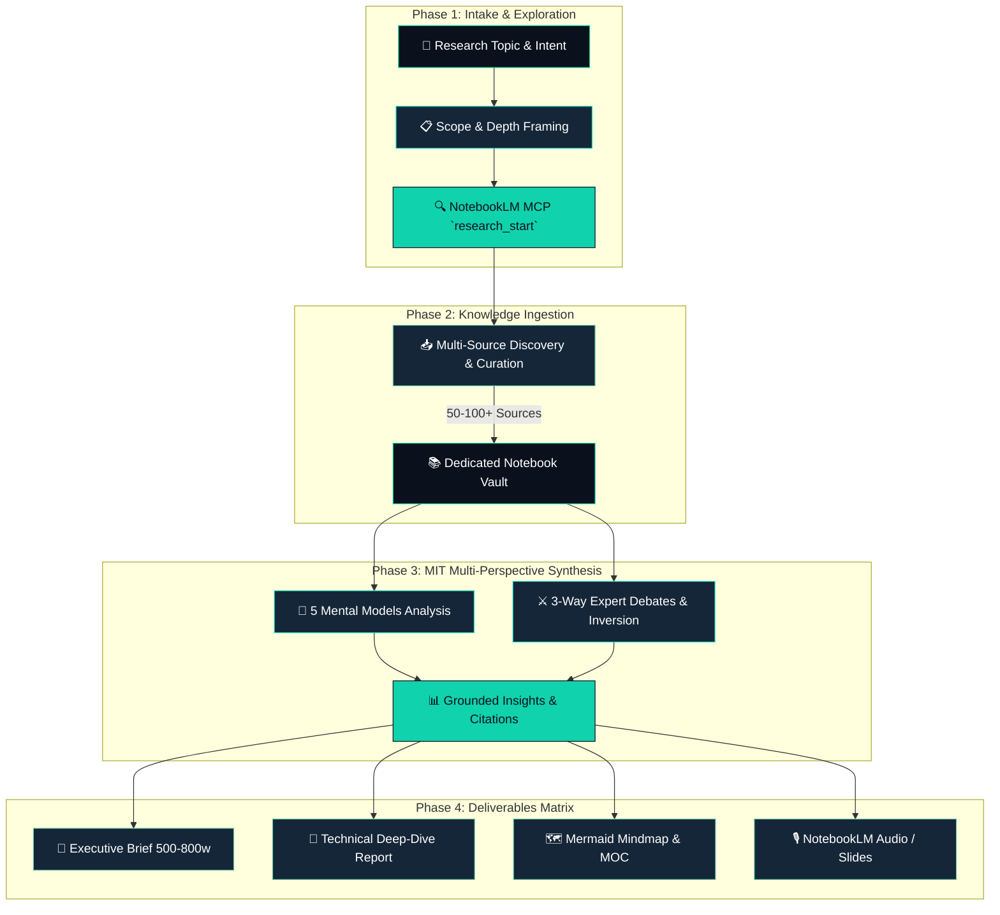

<div align="center">

# 🔬 notebooklm-research

[](https://github.com/floydiamarkv-byte/notebooklm-research/actions/workflows/ci.yml)
[](LICENSE)
### **Autonomous Deep Research Engine & Knowledge Vault Compiler**

[](https://floydia.site)
[](https://notebooklm.google.com)
[](https://floydia.site)
[](LICENSE)

<br/>

> **"Transform raw queries into rigorous, multi-perspective knowledge vaults. Built on NotebookLM MCP and the MIT Research Method to eliminate hallucinations."**

[🚀 Quick Start](#-quick-start) • [🏛️ Research Architecture](#-research-architecture) • [📦 Deliverables](#-structured-deliverables) • [🛠️ MCP Tools](#-mcp-tools-matrix) • [🤝 Support](#-author--support)

</div>

---

## 📌 Overview

**notebooklm-research** is an autonomous AI agent skill built for **Google Antigravity, OpenCode, Claude Code, and Cursor**. It orchestrates the official **Google NotebookLM MCP Server** to conduct exhaustive, multi-source investigations on any technical, scientific, or market domain.

Unlike simple web-search prompts that hallucinate summaries from top Google snippets, `notebooklm-research`:
1. **Curates 50 to 100+ Verified Sources**: Imports full papers, technical docs, and articles directly into private NotebookLM notebooks.
2. **Applies the MIT Deep Research Method**: Stress-tests findings across 5 Mental Models (First Principles, Second-Order Thinking, Inversion, Pareto, Red Teaming) and 3 Expert Debates.
3. **Compiles Complete Obsidian Knowledge Vaults (MOC)**: Delivers structured Markdown archives with inline grounding citations `[Source N]`, interactive mindmaps, audio overviews, and open inquiry matrices.

---

## 🏗️ Research Architecture



---

## 📦 Structured Deliverables

For every research task, the engine generates an isolated, publication-ready directory:

```
INVESTIGACION_{PROJECT_SLUG}/
├── README.md               ← Master Table of Contents with relational links
├── resumen_ejecutivo.md     ← High-impact 500-800 word executive briefing
├── informe_detallado.md     ← Exhaustive thesis with inline citations [Source N]
├── mapa_mental.md           ← Complete Mermaid mindmap hierarchy
├── fuentes.md               ← Verified source audit: URL, Date, Relevance score
└── preguntas_abiertas.md    ← Unresolved questions & future inquiry roadmap
```

---

## 🚀 Quick Start

### 1. Install Skill in Your Agent Environment

```bash
# For Google Antigravity / OpenCode / Claude Code
mkdir -p ~/.gemini/antigravity/skills/notebooklm-research
git clone https://github.com/floydiamarkv-byte/notebooklm-research.git ~/.gemini/antigravity/skills/notebooklm-research
```

### 2. Prerequisites
- Configured and running **NotebookLM MCP Server**
- Authenticated Google account with access to [NotebookLM](https://notebooklm.google.com)

### 3. Usage Examples

Just ask your AI agent naturally:
- *"Realiza una investigación profunda sobre arquitecturas de memoria vectorial para agentes autónomos."*
- *"Deep-dive research on Post-Quantum Cryptography standards for enterprise Linux."*
- *"Compila un dossier técnico sobre microservicios vs arquitecturas modulares en 2026."*

---

## 🛠️ MCP Tools Matrix

| Tool | Capability |
|------|------------|
| `notebook_create` | Initializes dedicated research workspace |
| `notebook_add_url/text` | Ingests URLs, PDFs, whitepapers & local files |
| `research_start` | Dispatches autonomous web & Drive deep searches |
| `research_poll` ➔ `research_import` | Evaluates and imports discovered citations |
| `notebook_query` | Grounded cross-querying without LLM hallucination |
| `report_create` | Formats comprehensive multi-chapter reports |
| `mind_map_generate` | Produces visual conceptual trees |
| `audio/video_overview_create` | Generates deep conversational podcast overviews |

---

## 👤 Author & Support

Developed by **[Floydia](https://floydia.site)** — Led by **Eliú Hurtado** (+25 years in IT systems, applied AI & automation).

* 🌐 **Website**: [https://floydia.site](https://floydia.site)
* 💼 **LinkedIn**: [Eliú Hurtado](https://linkedin.com/in/eliutec)
* 🐛 **Issues & Feedback**: [Open a GitHub Issue](https://github.com/floydiamarkv-byte/notebooklm-research/issues)

---

<div align="center">

Distributed under the [MIT License](LICENSE) • **Desde la infraestructura, todo.**

</div>
